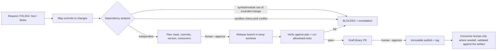

# Library Release Orchestrator

Release shared-library changes **in the order the business wants**, not the order they
were written, with evidence that the release is coherent, an immutable version, and
targeted dependency PRs for the services that need it. It ships as a Python engine plus
a Claude Code Skill (`/library-release`).

> **Status: proof of concept (v0.1.0).** The core engine, local adapters, Skill and demo
> are implemented and tested. It is **not production-ready**. See
> [Implementation status](#implementation-status) and [Limitations](#known-limitations).

## The problem

```
main:   v1.0.0 ── A (FIN-198, Zaid) ── B (FIN-204, Anas)
wanted: Release 1 = v1.0.0 + B      Release 2 = v1.0.0 + B + A
```

A sequential release process can only ship A+B together, or neither. The common
shortcuts are unsafe:

* **Renaming a version** ships A anyway.
* **Blind cherry-picking** can apply cleanly while B calls code that only A introduced.
  Git is satisfied, and the code breaks at import time.
* **Manual coordination** across N consumer services is slow and leaves no audit trail.

## How it works



1. **Git history ≠ business changes.** Commits are grouped into changes by Jira key
   (subject or `Refs:` trailer). Ambiguous or unmapped commits are reported, never guessed.
2. **Layered dependency evidence.** Python AST analysis finds symbols, modules and import
   bindings that the requested change uses but only an excluded change introduces
   (blocker). It flags symbols an excluded change *modified* (warning), and runs a real
   `cherry-pick` probe in a throwaway clone. A clean cherry-pick is never treated as proof.
3. **A deterministic plan.** Same inputs give byte-identical JSON and the same `plan_id`.
   The version comes from the release content and the **highest published** version.
4. **Safe execution.** The branch is built in a detached temporary worktree and created
   only after it verifies against the plan. Your checkout is never touched.
5. **Validation is the backstop.** Allowlisted commands from the trusted config run on a
   `git archive` export. Failures block the release (Scenario F).
6. **Immutable artifacts and targeted consumers.** A version is published once. Only
   consumers requested by the ticket or importing changed modules get a bump, validated
   against the published artifact.

More detail: [docs/architecture.md](docs/architecture.md) ·
[strategy comparison](docs/strategies.md) · [ADRs](docs/adr/) ·
[workflow and states](docs/release-workflow.md) · [security](docs/security.md) ·
[22 use cases](docs/use-cases.md) · [CLI reference](docs/cli.md)

## Install

Requires Python 3.11+ and Git 2.38+.

```bash
pip install -e ".[dev]"
```

## Quick start (fictional demo, fully offline)

```bash
release-orchestrator demo-init --dest ./.demo --scenario independent
cd .demo
release-orchestrator plan --ticket FIN-204 --out plan.json     # B without A -> 1.1.0
release-orchestrator prepare --plan plan.json --dry-run        # no mutation
release-orchestrator prepare --plan plan.json --approve        # release/1.1.0
release-orchestrator validate --plan plan.json
release-orchestrator pr --plan plan.json --approve             # local draft PR record
release-orchestrator publish --plan plan.json --approve        # immutable 1.1.0 + tag
release-orchestrator update-consumers --plan plan.json --approve   # payment-service only
release-orchestrator status --plan plan.json
```

Run every scenario and regenerate the results file:

```bash
python examples/demo/run_demo.py
```

The latest generated output is in [examples/demo/RESULTS.md](examples/demo/RESULTS.md).

| Scenario | Demo | Observed behaviour |
|---|---|---|
| A: independent | `independent` | `release/1.1.0` contains FIN-204 only; tests pass |
| B: dependent | `dependent` | `DEPENDENT`, blocked even though the cherry-pick is clean; FIN-198 named as prerequisite |
| C: conflict | `conflict` | `CONFLICT`, conflicting file and suspected cause reported; refs unchanged |
| D: consumers | `independent` | refused until published; then only `payment-service` bumped and tested |
| E: duplicate run | `independent` | identical plan, `already_prepared`, `already_published`, no duplicates |
| F: failing tests | `failing` | static analysis only warns; validation fails; PR and publish refused |

## Claude Code Skill

The Skill lives in [.claude/skills/library-release/](.claude/skills/library-release/SKILL.md).
Open Claude Code in a directory with a `release-orchestrator.yaml` and run:

```
/library-release FIN-204
/library-release FIN-204 --dry-run
/library-release "Release Change B before Change A"
/library-release FIN-204 --plan-only
```

Claude parses the arguments deterministically (`scripts/lro.py intake`), calls the CLI,
explains findings, and **asks before every write step**. It can't override a `BLOCKED`
result, and it never pushes, merges or deploys.

## Configuration

`release-orchestrator.yaml` is the **trusted** input. It is the only source of
validation commands. A full example is generated by `demo-init`.

```yaml
schema_version: 1
library:
  name: zaidlibrary
  repo: ./ZaidLibrary
  package_dir: src/zaidlibrary
  source_ref: main               # where pending work lives
  version_file: src/zaidlibrary/__init__.py
  # base_ref: v1.0.0             # default: highest vX.Y.Z tag
change_key_pattern: "[A-Z][A-Z0-9]+-\\d+"
aliases: {"change b": FIN-204}   # natural-language names -> keys
issue_tracker: {fixture: ./jira.yaml}
registry: {provider: local, path: ./registry}
pull_requests: {provider: local} # or: github (+ github_repositories, GITHUB_TOKEN)
validation:
  library:
    - name: unit-tests
      argv: ["{python}", "-m", "unittest", "discover", "-s", "tests", "-t", "."]
      env: {PYTHONPATH: "{library_path}/src"}
consumers:
  - name: payment-service
    repo: ./payment-service
    dependency_file: requirements.txt
    validation: [...]
```

## Testing

```bash
ruff check src tests .claude examples && ruff format --check src tests .claude examples
mypy --strict src/release_orchestrator
pytest -q                 # unit + integration (real temporary Git repos)
```

CI runs these on Linux and Windows with Python 3.11 and 3.12
([.github/workflows/ci.yml](.github/workflows/ci.yml)).

## Implementation status

| Area | Status |
|---|---|
| Git analysis, change mapping, multi-commit changes, ambiguity reporting | Implemented and tested |
| Python dependency analysis, sandbox apply probe, dependency graph | Implemented and tested |
| Release plan / manifest, schema validation, branch verification | Implemented and tested |
| SemVer, version policy, local immutable registry | Implemented and tested |
| Isolated release branches, dry-run, idempotency, run state machine | Implemented and tested |
| Allowlisted validation (library and consumers) | Implemented and tested |
| Consumer discovery and pin updates (`requirements.txt` `==` pins) | Implemented and tested |
| Local PR provider | Implemented and tested |
| GitHub PR provider (draft only, no merge) | Implemented and unit-tested with a fake transport; **not verified against live GitHub** |
| Jira REST provider | **Planned** (offline YAML fixture adapter only) |
| Remote registries (Artifactory, CodeArtifact, PyPI) | **Planned** |
| Non-Python language adapters | **Planned** (non-Python files are reported as unverified) |

## Security

Argv-only subprocess calls, a Git wrapper that refuses destructive operations, approval
gates on every write, untrusted ticket and commit text never executed, credentials
stripped from validation environments, and plan files that can't change which commands
run. See [docs/security.md](docs/security.md) for the model and its known gaps.

## Known limitations

* Static analysis is a heuristic for Python only. Runtime, data and configuration
  dependencies are left to the validation suite.
* Lockfiles other than `requirements.txt` `==` pins (Poetry, uv, pip-tools) aren't
  rewritten yet. Other pin styles are marked `manual`.
* Merge commits on the source branch aren't replayed. They are reported.
* Validation runs with the caller's privileges. Production use should run it in CI or a
  sandbox.
* The local registry's atomicity covers one filesystem. Cross-machine safety depends on
  the real registry refusing re-uploads (ADR-0005).

## Roadmap

1. Live GitHub verification (push via the user's credentials, draft PRs, CI status).
2. Jira REST adapter (read-only service account) and PR-reference resolution.
3. Remote registry adapters with create-if-absent semantics.
4. Poetry, uv and pip-tools lockfile updaters. Consumer impact from symbol usage, not
   only module imports.
5. Run validation in containers. Artifact provenance attestation (SLSA/Sigstore).
6. More language adapters (TypeScript, Java) behind the same analyzer interface.

## License

MIT. All demo data is fictional.
