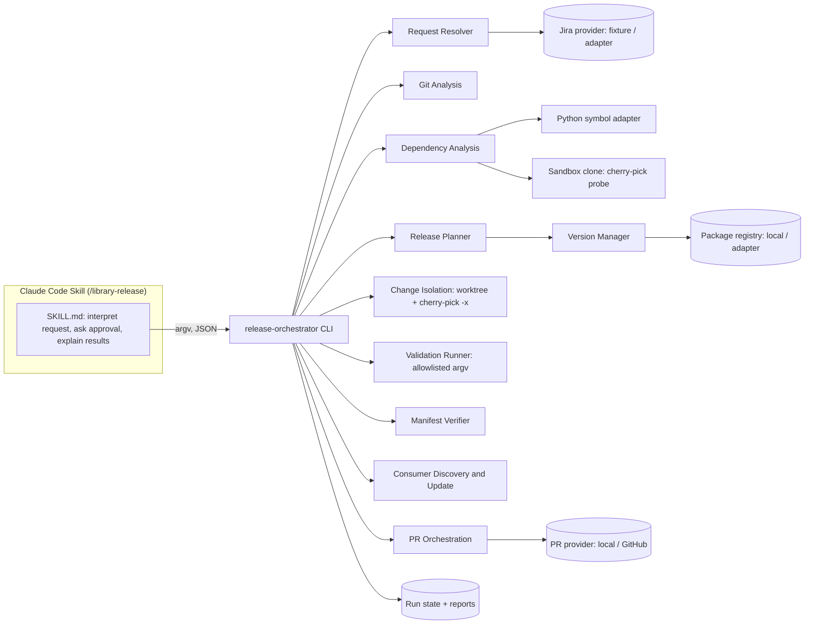

# Architecture

> Status: describes the implemented POC (`v0.1.0`). Planned items are labelled **[planned]**.

## 1. Problem statement

`ZaidLibrary` is a shared Python library used by several microservices
(`payment-service`, `invoice-service`, …). Many developers change it often, and new
work is usually built on top of earlier, unreleased work. The business decides
**what ships when**, and that order often differs from the order in which the code
was written.

```
Development history:  v1.0.0 ── A (FIN-198, Zaid) ── B (FIN-204, Anas)      (main)
Business wants:       Release 1 = v1.0.0 + B
                      Release 2 = v1.0.0 + B + A
```

The usual fixes are risky:

* **Renaming versions** ("call the A+B build 1.1.0") ships A anyway.
* **Blind cherry-picking** of B onto `v1.0.0` can succeed textually while B calls
  code that only A introduced. The result imports cleanly in Git and breaks at
  runtime.
* **Manual coordination** across consumer repositories doesn't scale, and it
  leaves no audit trail.

### Development order vs. release order

The project keeps seven concepts apart because they change independently:

| Concept | Owner | Model in this project |
|---|---|---|
| Git commit history | developers | `CommitInfo` (full SHA, parents, files, trailers) |
| Logical business change | product / Jira | `ChangeUnit` (key, commits, provenance) |
| Code-level dependency | the code | `DependencyFinding` edges in a `ChangeGraph` |
| Library version | release engineering | `SemVer`, version policy |
| Published artifact | package registry | `PublishedArtifact` (version + sha256 digest), immutable |
| Consumer adoption | each service team | `ConsumerUpdate` (current pin → proposed pin) |
| Production deployment | each service's pipeline | **out of scope**: never performed |

**Primary goal:** decouple release planning from the order of development, while
keeping releases correct, compatible, reproducible and auditable.

## 2. Requirements

### Functional

1. Accept a Jira key, a natural-language request, a PR reference or explicit commits.
2. Map commits to logical changes in a deterministic way. Report ambiguous or
   missing mappings and never guess.
3. Decide whether the requested changes can be released without the excluded ones,
   and say how confident that decision is.
4. Produce a deterministic, versioned release plan (manifest).
5. Recommend a SemVer version that cannot collide with a published version.
6. Build a release branch in isolation, with commit-level provenance.
7. Run trusted, allowlisted validation commands. Report failures and never skip them.
8. Check that the actual release branch matches the approved plan.
9. Publish an immutable artifact to a registry (local registry in the POC).
10. Find the consumers a change affects, then prepare and validate dependency
    updates only for those.
11. Prepare pull requests through an adapter. Never merge them.
12. Write JSON and Markdown reports, and keep the state of each run.

### Non-functional

* **Safety:** no force-push, merge, deploy, version overwrite or branch deletion.
  Every repository write needs an explicit `--approve`.
* **Determinism:** the same inputs give the same plan ID and the same plan bytes.
* **Idempotency:** re-running a step recognises results that already exist.
* **Non-mutating dry-run:** proven by tests that snapshot refs, the index, worktrees
  and the working tree.
* **Portability:** Python 3.11+, Git 2.38+, Linux/macOS/Windows.
* **Testability:** core logic doesn't depend on Claude, GitHub or Jira.

## 3. Assumptions and limitations

* Commits carry their business change key in the subject or in a `Refs:` trailer
  (for example `FIN-204: add tax calculation`). A commit that names two keys is
  reported as **ambiguous**.
* The library is Python. Static dependency analysis is Python-specific. Changes to
  non-Python files are reported as **unverified** and are never assumed safe.
* Static analysis is a **conservative heuristic, not a proof**. It catches symbol
  and module dependencies introduced by excluded changes. It can't catch runtime or
  data dependencies; the validation suite is the backstop for those.
* The local registry's `O_CREAT|O_EXCL` publish is atomic on one filesystem only.
  Coordination between machines relies on the real registry refusing to overwrite
  a version (PyPI, Artifactory and CodeArtifact all do). See ADR-0005.
* The configuration file is trusted input. Jira text, commit messages and PR text
  are not.

## 4. Architecture



### Component responsibilities

| Component | Module | Responsibility |
|---|---|---|
| Input & Requirement Resolver | `requests.py`, `integrations/jira.py` | Normalise Jira keys, aliases ("Change B"), PR refs and SHAs into change keys. Raise `AmbiguousRequestError` when something is unclear. |
| Git Analysis Engine | `gitutil/repo.py`, `gitutil/history.py` | Safe `subprocess` wrapper (argv lists, no shell). Lists commits, files, patches, `patch-id`s and tags. Groups commits into `ChangeUnit`s. |
| Dependency Analysis Engine | `analysis/` | Shared files, hunk overlap, Python symbol and module dependencies, a real cherry-pick probe in a sandbox clone, and a change graph with cycle detection. |
| Release Planning Engine | `planning/planner.py` | Builds the `ReleasePlan` and computes prerequisites and remediation options. The plan ID is a content hash. |
| Version Management Engine | `versioning/` | Strict SemVer 2.0 parsing and precedence, bump policy (conventional commits plus API-removal detection), collision detection against registry and tags, immutable publish. |
| Change Isolation Engine | `isolation/` | Temporary worktree at a detached base, `cherry-pick -x`, conflict capture, `--abort`. The branch is created **only after full success**, so a failed run leaves no branch behind. |
| Validation Engine | `validation/runner.py` | Runs allowlisted argv commands from the trusted config against a `git archive` export: the committed content only, with no repository mutation. |
| Manifest Verifier | `planning/manifest.py` | Schema validation, plus proof that the release branch matches the plan: ancestry, cherry-pick trailers, `patch-id` equality, no extra commits. |
| Caller Discovery & Update | `consumers/` | Finds consumers that pin the library. Uses import analysis and ticket metadata to pick the relevant ones. Rewrites pins on a branch and validates against the published artifact. |
| PR Orchestration | `integrations/pull_requests.py`, `integrations/github.py` | `PullRequestProvider` protocol. The local provider is fully tested. The GitHub REST adapter creates **draft** PRs and has no merge method. |
| Audit & Reporting | `reporting/`, `state.py` | JSON and Markdown reports, a run state machine, and a persisted transition history. |

The **core never imports Claude-specific code**. The Skill is a thin operator that
calls the CLI and interprets its JSON.

## 5. End-to-end workflow

```mermaid
sequenceDiagram
  actor U as Engineer
  participant C as Claude Skill
  participant O as Orchestrator CLI
  participant G as Git (library)
  participant R as Registry
  participant P as PR provider
  U->>C: /library-release FIN-204
  C->>O: analyze --ticket FIN-204
  O->>G: read history, sandbox cherry-pick probe
  O-->>C: AnalysisResult (verdict, findings)
  C->>O: plan --ticket FIN-204 --out plan.json
  O-->>C: PLAN_READY / BLOCKED + remediation
  C->>U: show plan, ask approval
  U-->>C: approve
  C->>O: prepare --plan plan.json --approve
  O->>G: worktree, cherry-pick -x, version commit, branch
  C->>O: verify --plan plan.json
  C->>O: validate --plan plan.json
  C->>O: pr --plan plan.json --approve
  O->>P: draft PR (no merge)
  Note over U,R: Publishing happens after human merge (CI in production;<br/>`publish --approve` in the POC)
  C->>O: update-consumers --plan plan.json --approve
  O->>R: version available?
  O->>P: consumer PRs only for affected services
```

Run states and transitions are described in
[release-workflow.md](release-workflow.md).

## 6. Release safety guarantees

| Guarantee | Mechanism | Test |
|---|---|---|
| No mutation in dry-run or analysis | Probes run in a throwaway `git clone`. Validation runs on `git archive` output. | `test_dry_run_is_non_mutating` |
| Requested change released without excluded ones | Verifier checks every release commit's `patch-id` against the plan | `test_scenario_independent_*`, `test_verify_detects_*` |
| Dependent change never reported as independent | Symbol and module analysis marks it `DEPENDENT`, which blocks the plan | `test_scenario_dependent_*` |
| Conflicts leave repository unchanged | Detached worktree, `cherry-pick --abort`, worktree removed, no branch created | `test_scenario_conflict_*` |
| Published versions immutable | `O_EXCL` create plus digest comparison | `test_registry_*` |
| Validation failures block readiness | Non-zero exit or timeout gives `FAILED`; a step that wasn't run is never `PASSED` | `test_scenario_failed_validation_*` |
| Consumer PR only after artifact exists | `update-consumers` refuses with `BLOCKED` when the version is missing from the registry | `test_consumer_update_requires_published_version` |
| Writes require approval | Write commands exit with code 4 without `--approve` | `test_cli_requires_approval` |
| No merge or force-push | No code path issues `merge`, `push --force` or a PR merge API call | code review + `test_git_wrapper_rejects_forbidden_commands` |

## 7. Failure handling and recovery

* Each step is **idempotent**. The plan ID (sha256 of canonical plan content)
  identifies the run, and each step checks for an existing result before acting.
  * `prepare`: if the release branch exists **and** passes verification against the
    plan, it is reused (`already_prepared`). If it exists with different content,
    the step stops with `BLOCKED` and leaves the branch untouched.
  * `publish`: same version with the same digest returns `already_published`. Any
    other digest raises `ImmutableVersionError`.
  * PR creation: an existing PR for the same head branch is returned.
* **Partial failure:** run state records the last successful step. Re-running
  resumes from there, because completed steps report "already done".
* **Cleanup** removes only temporary worktrees and clones created by the current
  process. It never removes a user branch.

## 8. Security considerations

See [security.md](security.md). In summary: argv-only subprocess calls, allowlisted
validation commands from trusted config, untrusted ticket text that is never
executed or used as a path, tokens read only from environment variables and never
logged, and branch names checked with `git check-ref-format`.

## 9. Alternatives and trade-offs

See [strategies.md](strategies.md) for the comparison of release strategies and
[adr/](adr/) for the decisions.
