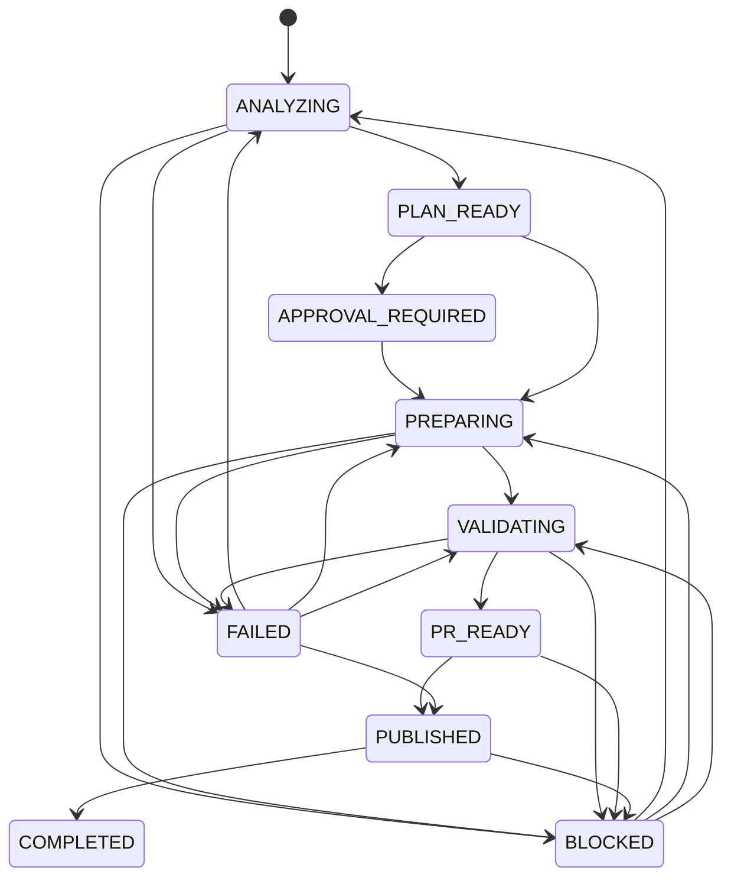

# Release workflow and state machine

Each release run is identified by its **plan ID**: the first 16 hex characters of a
sha256 over the canonical JSON of the plan's content fields (library, base SHA,
included commit SHAs, version, consumers). The same inputs always produce the same
plan ID. Run state is stored in `<state_dir>/runs/<plan_id>.json`, with a
timestamped transition history.

## States

| State | Meaning |
|---|---|
| `ANALYZING` | Request resolved; analysis in progress. |
| `PLAN_READY` | A plan with no blocking findings exists. Nothing has been written to any repository. |
| `APPROVAL_REQUIRED` | A write step was requested without `--approve`. Nothing was written. |
| `PREPARING` | The release branch is being built in an isolated worktree. |
| `VALIDATING` | Branch verified against the plan; allowlisted tests are running. |
| `PR_READY` | Branch verified **and** validation passed. Library PR can be or has been prepared. |
| `PUBLISHED` | Immutable artifact published to the registry. |
| `COMPLETED` | Consumer update PRs prepared for every targeted consumer. |
| `BLOCKED` | A safety rule stopped progress (dependency, conflict, failing tests, collision, manifest mismatch). Needs human action or a re-plan. |
| `FAILED` | Unexpected operational error (Git failure, I/O). Safe to retry. |

## Transitions

These transitions are enforced in code (`state.TRANSITIONS`). An invalid
transition raises `InvalidTransitionError`. Repeating an already completed step
returns `already_*` results and does not move the state backwards. For example,
calling `prepare` while the run is in `PR_READY` reports `already_prepared` and
leaves the state unchanged.

## Steps

| Step (CLI) | Writes? | Needs approval | Precondition | Result state |
|---|---|---|---|---|
| `analyze` | no | no | config valid | none (no run created) |
| `plan` | only `--out` file and run state | no | analysis not blocked | `PLAN_READY` / `BLOCKED` |
| `prepare --dry-run` | no | no | plan valid | unchanged |
| `prepare` | release branch in library repo | **yes** | `PLAN_READY` | `VALIDATING` / `BLOCKED` |
| `verify` | no | no | branch exists | unchanged (report) |
| `validate` | no (runs in temporary export) | no | branch verified | `PR_READY` / `BLOCKED` |
| `pr` | PR record | **yes** | `PR_READY` | `PR_READY` (+PR ref) |
| `publish` | registry entry | **yes** | `PR_READY` | `PUBLISHED` |
| `update-consumers` | branches in consumer repos plus PR records | **yes** | version present in registry | `COMPLETED` / `BLOCKED` |
| `status` | no | no | none | none |

In production, `publish` should run from CI after the library PR has been reviewed
and merged by a human. The POC exposes it as an approved CLI step so that the
consumer-update flow can be shown end to end.
